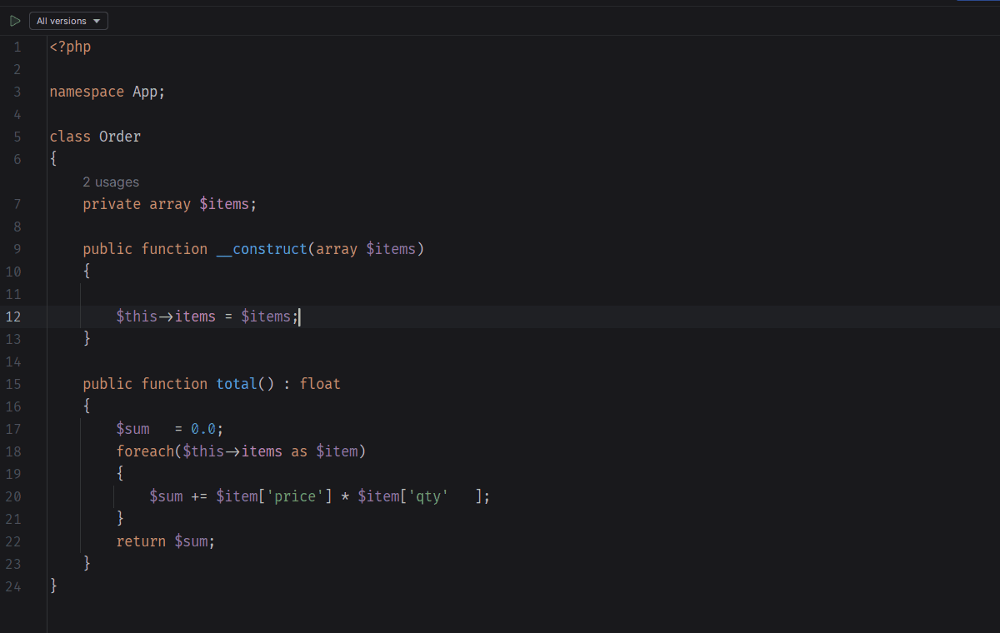

# StormFox

[](https://plugins.jetbrains.com/plugin/35857)
[](https://plugins.jetbrains.com/plugin/35857)

[Mago](https://mago.carthage.software/) integration for PhpStorm: format PHP and Twig code and inspect stylistic issues, inconsistencies, and code smells using your project's Mago configuration.



Works with PhpStorm 2024.3+ and IntelliJ IDEA 2024.3+.

Feel free to [report issues](https://github.com/downace/StormFox/issues) if you encounter errors or need more features.
See [Troubleshooting](#troubleshooting) for collecting logs to include in a bug report.

## Setup

1. Install [Mago](https://mago.carthage.software/) and make sure it runs on your machine.
2. Install StormFox plugin from the [releases page](https://github.com/downace/StormFox/releases), [JetBrains Marketplace](https://plugins.jetbrains.com/plugin/35857), or directly in the IDE via **Settings | Plugins | Marketplace** (search for **StormFox** or **Mago**).
   > The marketplace version may lag behind GitHub releases
3. Open **Settings | PHP | Quality Tools | Mago** and set **Mago command** to the binary path or a command that starts Mago.

### Docker and Docker Compose

The command is a launch prefix: StormFox appends the Mago subcommand and arguments.
For the [official Docker image](https://mago.carthage.software/latest/en/guide/installation/#docker), for example:

```shell
docker run --rm -i -v .:/app -w /app ghcr.io/carthage-software/mago:1.60.1
```

Set **Execution project root** to `/app`, the directory corresponding to the local project root.

## Usage

### Formatter

> Twig formatting require Mago 1.60 or newer.

In **Settings | PHP | Quality Tools | Mago**, select **PHP**, **Twig**, or both under
**Use Mago formatter for**. The **Reformat code** action uses Mago for the selected file types.

Turn on **Reformat code** in **Settings | Tools | Actions on Save** to format the selected
file types with Mago on save.


### Linter, Analyzer and Guard

> Twig linting require Mago 1.60 or newer.

Enable corresponding inspection in **Settings | Editor | Inspections | PHP | Quality tools**
and **Settings | Editor | Inspections | Twig | Quality tools**
to show Mago findings in the editor.

## Things to know

* While Mago formatter is on, Mago replaces the IDE code style for PHP files: the
  **Settings | Editor | Code Style | PHP** page no longer affects them.
* Only whole files are formatted. Mago cannot format a fragment, so selections and "changed lines
   only" ranges are handled by the IDE's own formatter.

## Troubleshooting

Open **Help | Show Log in Explorer** and look in `idea.log` for entries whose logger
category contains `com.github.downace.stormfox`. Normal logging records failures and
important state changes.

For detailed logging, open **Help | Diagnostic Tools | Debug Log Settings**
and add this category:

```text
#com.github.downace.stormfox
```

To trace diagnostic caching, cancellation and highlighting updates, use TRACE
instead:

```text
#com.github.downace.stormfox:trace
```

Reproduce the problem, then remove the category to disable detailed logging.

**DEBUG and TRACE may contain the full command line, secrets in its arguments,
paths, source code and the complete Mago output.** Review the log and remove sensitive
data before sharing it.
