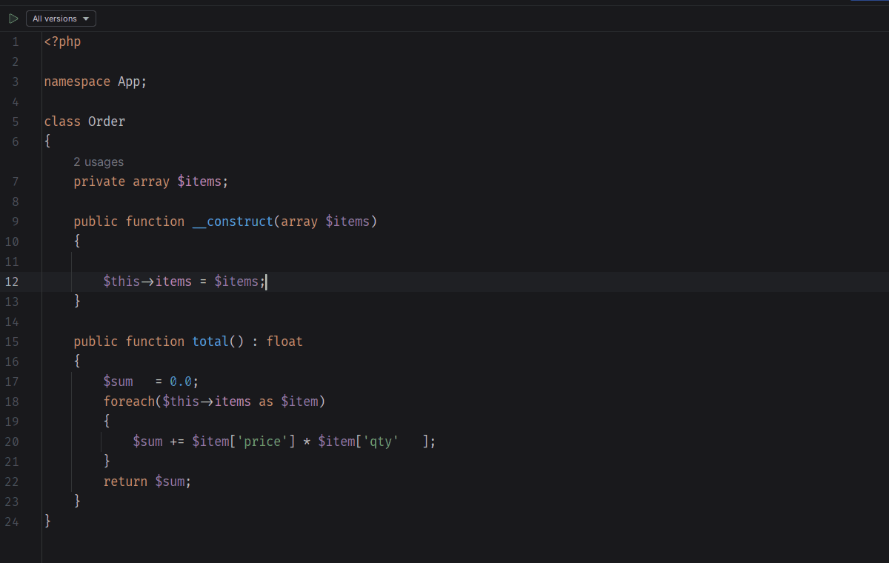

# StormFox

PhpStorm plugin that formats PHP files with [Mago](https://mago.carthage.software/), a PHP toolchain written in Rust.

Requires PhpStorm 2024.3 or newer.

### Setup

1. Install [Mago](https://mago.carthage.software/) and make sure it runs on your machine.
2. Open **Settings → PHP → Quality Tools → Mago**, set **Mago executable** to the binary and turn
   on **Use Mago formatter**.

### Usage

Turn on **Use Mago formatter** in **Settings → PHP → Quality Tools → Mago**,
so **Reformat code** action will use Mago instead of default formatter for PHP files.

Turn on **Reformat code** in **Settings → Tools → Actions on Save**, so Mago is used to format PHP files on save.

### Things to know

* While the formatter is on, Mago replaces the IDE code style for PHP files: the
  **Settings → Editor → Code Style → PHP** page no longer affects them.
* Only whole files are formatted. Mago cannot format a fragment, so selections and "changed lines
  only" ranges are handled by the IDE's own formatter.

### Upcoming Features

* [Linter](https://mago.carthage.software/1.59.0/en/tools/linter/overview/) support.
* [Analyzer](https://mago.carthage.software/1.59.0/en/tools/analyzer/overview/) support.
* [Guard](https://mago.carthage.software/1.59.0/en/tools/guard/overview/) support.
